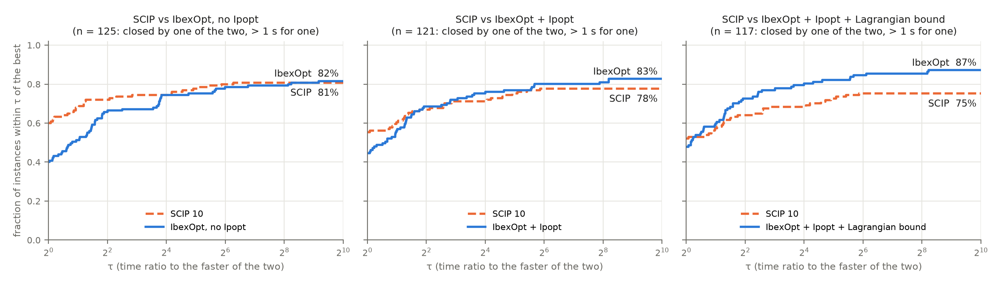
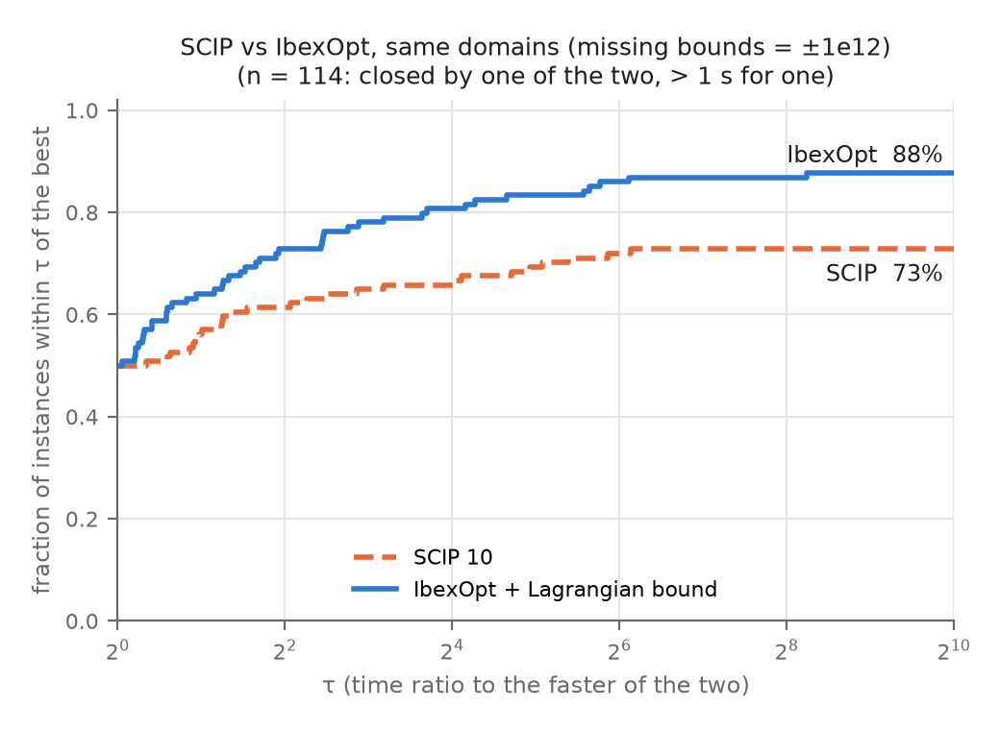

# Local runs (EXPERIMENTS.md §9)

## Machine

- CPU: 2 x Intel Xeon E5-2620 v4 @ 2.10 GHz (Broadwell, turbo 3.0 GHz), 16 physical
  cores, no hyperthreading; 62 GB RAM. Governor `schedutil`.
- OS: Ubuntu 24.04.1 LTS, gcc 13.3.0.
- Ipopt 3.11.9 (`coinor-libipopt-dev`, libmumps-seq 5.6.2). The machine also has an
  Ipopt 3.14.19 in `/usr/local` that pkg-config finds first, so the build was
  configured with
  `PKG_CONFIG_LIBDIR=/usr/lib/x86_64-linux-gnu/pkgconfig:/usr/lib/pkgconfig:/usr/share/pkgconfig`
  (CMake reports `Ipopt 3.11.9 found`; `ldd` shows `libipopt.so.1`).
- Build: `cmake .. -DCMAKE_BUILD_TYPE=Release -DLP_LIB=soplex -DIBEX_WITH_IPOPT=ON`
  (-O3), commit c605c1afb (last `src/` change: 95afa9ad5).
- All runs: JOBS=14, TLIM=600. Shared machine (other users logged in), load < 1
  before each run.

## E0: validation of the build

```bash
env OUT=results/local/runs-closed.jsonl BIN=build-fix/bin/ibexopt-ml JOBS=14 TLIM=600 ARMS="abase" sh results/ipopt-diam/run.sh
python3 results/paper/compare.py --tlim 600 --closed-file results/local/runs-closed.jsonl \
    --open-file results/local/runs-open.jsonl --set closed --ref abase abase
```

Wall time: 10 min (09:06-09:16, 2026-11-10).

- 223/223 complete, no killed runs.
- **Same node counts as the cloud `abase` on 221/223 instances (99.1 %) -> passes
  (>= 98 %).** Differences: `launch` (16 -> 26 nodes), `robot` (75742 -> 75882).
- **Speed: this machine is about 2.7x slower than the cloud container per run.**
  local/cloud time ratio on the 55 instances with equal nodes and > 1 s in the cloud:
  median 2.73, p10 2.36, p90 2.99 (geometric mean 2.35 on 73 with > 1 s in either).
  It is not load: `ex6_2_11` and `ex6_2_6` alone give the same times as under JOBS=14
  (10.2 s, 25.0 s vs 3.4 s, 8.2 s in the cloud), and the ratio is the same inside
  Ipopt (ipopt_time 3x). Consequence: TLIM=600 here is worth about 220 s of the cloud
  container, less than the 310 s of the cloud runs, so the 75 "open" instances are
  not expected to close more often here than in the cloud.

```
instances with every arm: 223, common set: 75, closed by every arm: 223
| arm | closed | n (closes) | time vs abase [IC95] | W/L | nodes | t/node | ipopt% | bound% |
|---|---|---|---|---|---|---|---|---|
| abase | 223 | 75 (75) | 1.00 [1.00, 1.00] | 0/0 | 1.00 | 1.00 | 2.9 | 0.0 |
```

## Time limit: 1200 s from E1 on

Given the 2.7x slowdown above, TLIM was raised from 600 to **1200 s** for E1 and
later (about 440 s of the cloud container, above its 310 s). The E0 `abase` runs are
kept: all 223 closed in < 600 s (max 578 s), and the search is deterministic, so a
1200 s limit gives the same result. compare.py is run with `--tlim 1200`.

## E1: final ablation, 223 set

```bash
env OUT=results/local/runs-closed.jsonl BIN=build-fix/bin/ibexopt-ml JOBS=14 TLIM=1200 ARMS="anoip abase acvx0" sh results/ipopt-diam/run.sh
python3 results/paper/compare.py --tlim 1200 --closed-file results/local/runs-closed.jsonl \
    --open-file results/local/runs-open.jsonl --set closed --ref abase anoip abase acvx0
```

Wall time: 26 min (09:21-09:47, 2026-11-10; `abase` skipped, from E0). Max time of a
closed run: abase 578 s, acvx0 526 s.

```
instances with every arm: 223, common set: 93, closed by every arm: 219
| arm | closed | n (closes) | time vs abase [IC95] | W/L | nodes | t/node | ipopt% | bound% |
|---|---|---|---|---|---|---|---|---|
| abase | 223 | 93 (93) | 1.00 [1.00, 1.00] | 0/0 | 1.00 | 1.00 | 2.9 | 0.0 |
| anoip | 219 | 93 (90) | 1.68 [1.36, 2.14] | 14/56 | 3.00 | 0.85 | 0.0 | 0.0 |
| acvx0 | 223 | 93 (93) | 0.85 [0.73, 0.95] | 18/0 | 0.80 | 1.01 | 3.2 | 0.3 |
```

acvx0 passes the acceptance rule against abase (0.85, IC95 [0.73, 0.95] < 1; 18 wins,
0 losses).

anoip does not close `eigencco`, `dnieper`, `ex7_2_3` (timeout at 1200 s) and
**`robot` is `killed`** (no output; `timeout` kills it at TLIM+200 s). Same as in the
cloud runs (`results/ipopt-diam/runs.jsonl`: robot/anoip `killed`). It is a hang, not a
crash: with `--timeout 30` it is still running at 120 s, at 100 % CPU and 14 MB RSS.
Backtrace (gdb, interrupted at 40 s):

```
ibex::Interval::pi()
ibex::ibwd_trigo(...)
ibex::CompiledFunction::backward<ibex::InHC4Revise>(...)
ibex::InHC4Revise::iproj(...)
ibex::LoupFinderInHC4::find(...)
ibex::LoupFinderDefault::find(...)
ibex::Optimizer::update_loup(...)
ibex::Optimizer::contract_and_bound(...)
```

i.e. the inner projection of a trigonometric term in LoupFinderInHC4 (used only by
`--loup default`, i.e. anoip) does not return and the time limit is not checked inside
it. compare.py excludes `killed` runs from the common set.

## E2: certify only vs shift, 223 set

```bash
env OUT=results/local/runs-closed.jsonl BIN=build-fix/bin/ibexopt-ml JOBS=14 TLIM=1200 ARMS="acert0 acert1" sh results/ipopt-diam/run.sh
python3 results/paper/compare.py --tlim 1200 --closed-file results/local/runs-closed.jsonl \
    --open-file results/local/runs-open.jsonl --set closed --ref abase abase acvx0 acert0 acert1
python3 results/paper/compare.py --tlim 1200 --closed-file results/local/runs-closed.jsonl \
    --open-file results/local/runs-open.jsonl --set closed --ref acvx0 acvx0 acert0 acert1
```

Wall time: 12.5 min (10:42-10:55, 2026-11-10). 223/223 complete in both arms (max
585 s), nothing killed.

```
instances with every arm: 223, common set: 76, closed by every arm: 223
| arm | closed | n (closes) | time vs abase [IC95] | W/L | nodes | t/node | ipopt% | bound% |
|---|---|---|---|---|---|---|---|---|
| abase | 223 | 76 (76) | 1.00 [1.00, 1.00] | 0/0 | 1.00 | 1.00 | 2.9 | 0.0 |
| acvx0 | 223 | 76 (76) | 0.81 [0.67, 0.94] | 19/0 | 0.80 | 1.01 | 3.3 | 0.3 |
| acert0 | 223 | 76 (76) | 0.87 [0.71, 1.01] | 6/1 | 0.83 | 1.00 | 3.2 | 0.0 |
| acert1 | 223 | 76 (76) | 0.78 [0.62, 0.92] | 11/0 | 0.71 | 1.00 | 3.1 | 0.0 |

instances with every arm: 223, common set: 71, closed by every arm: 223
| arm | closed | n (closes) | time vs acvx0 [IC95] | W/L | nodes | t/node | ipopt% | bound% |
|---|---|---|---|---|---|---|---|---|
| acvx0 | 223 | 71 (71) | 1.00 [1.00, 1.00] | 0/0 | 1.00 | 1.00 | 3.3 | 0.3 |
| acert0 | 223 | 71 (71) | 1.08 [1.03, 1.13] | 0/15 | 1.04 | 0.99 | 3.2 | 0.0 |
| acert1 | 223 | 71 (71) | 0.95 [0.83, 1.06] | 5/14 | 0.90 | 0.99 | 3.1 | 0.0 |
```

- acert0 (Gerschgorin certification only) is slower than the shift: 1.08 [1.03, 1.13]
  vs acvx0, 0 wins / 15 losses.
- acert1 (+ comparison matrix and interval Cholesky) is not distinguishable from
  acvx0 in time (0.95 [0.83, 1.06]), with 5 wins / 14 losses but **fewer nodes (0.90
  vs acvx0, 0.71 vs abase)**. Unexpected: a certify-only bound should not prune more
  than the shifted one; to look at per instance (which instances drive the node ratio).
- The common set differs from E1 (76 vs 93) because anoip is not in these tables.

Per instance (acert1 vs acvx0): 27 instances differ in nodes, 8 with fewer nodes in
acert1. The geometric mean is driven by 4 convex problems that acert1 closes at the
root (0 nodes) because the interval Cholesky certifies convexity there, while the
Gerschgorin shift of acvx0 does not prune at the root: `dualc5` (23186 nodes, 47.6 s
-> 0), `dualc1` (522 -> 0), `dualc1__coconut` (534 -> 0), `meanvar` (534 -> 0). The
shift is better elsewhere: `ex6_2_6` (13914 vs 27000 nodes), `ex6_2_8` (8660 vs
13672), `dnieper` (150 vs 434). Suggests combining both (certify with Cholesky, shift
when it fails).

## E3: variants (scaled shift, no backoff), 223 set

```bash
env OUT=results/local/runs-closed.jsonl BIN=build-fix/bin/ibexopt-ml JOBS=14 TLIM=1200 ARMS="ascaled anobo" sh results/ipopt-diam/run.sh
python3 results/paper/compare.py --tlim 1200 --closed-file results/local/runs-closed.jsonl \
    --open-file results/local/runs-open.jsonl --set closed --ref acvx0 acvx0 ascaled anobo
python3 results/paper/compare.py --tlim 1200 --closed-file results/local/runs-closed.jsonl \
    --open-file results/local/runs-open.jsonl --set closed --ref abase abase acvx0 ascaled anobo
```

Wall time: 11.5 min (10:55-11:07, 2026-11-10). 223/223 complete in both arms (max
509 s), nothing killed.

```
instances with every arm: 223, common set: 71, closed by every arm: 223
| arm | closed | n (closes) | time vs acvx0 [IC95] | W/L | nodes | t/node | ipopt% | bound% |
|---|---|---|---|---|---|---|---|---|
| acvx0 | 223 | 71 (71) | 1.00 [1.00, 1.00] | 0/0 | 1.00 | 1.00 | 3.3 | 0.3 |
| ascaled | 223 | 71 (71) | 0.99 [0.95, 1.04] | 6/1 | 1.00 | 1.00 | 3.4 | 0.3 |
| anobo | 223 | 71 (71) | 1.02 [1.00, 1.05] | 3/1 | 1.00 | 1.00 | 3.3 | 2.3 |

instances with every arm: 223, common set: 76, closed by every arm: 223
| arm | closed | n (closes) | time vs abase [IC95] | W/L | nodes | t/node | ipopt% | bound% |
|---|---|---|---|---|---|---|---|---|
| abase | 223 | 76 (76) | 1.00 [1.00, 1.00] | 0/0 | 1.00 | 1.00 | 2.9 | 0.0 |
| acvx0 | 223 | 76 (76) | 0.81 [0.67, 0.94] | 19/0 | 0.80 | 1.01 | 3.3 | 0.3 |
| ascaled | 223 | 76 (76) | 0.81 [0.66, 0.94] | 19/1 | 0.79 | 1.00 | 3.4 | 0.3 |
| anobo | 223 | 76 (76) | 0.83 [0.67, 0.96] | 19/2 | 0.79 | 1.01 | 3.3 | 2.3 |
```

- ascaled (scaled Gerschgorin): same as acvx0 (0.99 [0.95, 1.04], same nodes).
- anobo (no backoff): same nodes, bound time 2.3 % of the total instead of 0.3 %, so
  slightly slower (1.02 [1.00, 1.05]); the backoff only saves bound evaluations.

## E1: final ablation, 75 set (and all 298)

```bash
env OUT=results/local/runs-open.jsonl BIN=build-fix/bin/ibexopt-ml JOBS=14 TLIM=1200 ARMS="anoip abase acvx0" sh results/anytime/run.sh
python3 results/paper/compare.py --tlim 1200 --closed-file results/local/runs-closed.jsonl \
    --open-file results/local/runs-open.jsonl --set open --ref abase anoip abase acvx0
python3 results/paper/compare.py --tlim 1200 --closed-file results/local/runs-closed.jsonl \
    --open-file results/local/runs-open.jsonl --set all --ref abase anoip abase acvx0
```

Wall time: 4 h 21 min (11:07-15:28, 2026-11-10).

```
instances with every arm: 75, common set: 12, closed by every arm: 4
| arm | closed | n (closes) | time vs abase [IC95] | W/L | nodes | t/node | ipopt% | bound% |
|---|---|---|---|---|---|---|---|---|
| abase | 6 | 12 (4) | 1.00 [1.00, 1.00] | 0/0 | 1.00 | 1.00 | 11.0 | 0.0 |
| anoip | 4 | 12 (2) | 1.23 [0.99, 1.82] | 1/3 | 1.10 | 0.85 | 0.0 | 0.0 |
| acvx0 | 14 | 12 (12) | 0.03 [0.00, 0.14] | 8/0 | 1.00 | 1.00 | 11.1 | 0.0 |

instances with every arm: 298, common set: 105, closed by every arm: 223
| arm | closed | n (closes) | time vs abase [IC95] | W/L | nodes | t/node | ipopt% | bound% |
|---|---|---|---|---|---|---|---|---|
| abase | 229 | 105 (97) | 1.00 [1.00, 1.00] | 0/0 | 1.00 | 1.00 | 5.2 | 0.0 |
| anoip | 223 | 105 (92) | 1.62 [1.33, 2.04] | 15/59 | 2.94 | 0.85 | 0.0 | 0.0 |
| acvx0 | 237 | 105 (105) | 0.57 [0.41, 0.75] | 26/0 | 0.80 | 1.01 | 5.6 | 0.2 |
```

Instances of the 75 "open" set closed in 1200 s (time in s):

- anoip (4): hs118 (0), wall (0), hs093 (554), mistake (733)
- abase (6): hs118 (0), wall (0), chenery-1 (119), hs093 (603), mistake (639), hs102 (1112)
- acvx0 (14): the 6 of abase (same times) + abel (0), abelbis-1 (0), abelter-1 (0),
  catena (0), abelbis (3), fccu (20), ex8_4_1 (69), polak3 (85)

Statuses, every arm: `infeasible` ex7_3_6, launch__coconut; `no_lower_bound` (9):
3pk, ex8_4inf-1, ex8_5_6-1, like, like-1, modele_opti, ship, test_infinity3,
test_infinity4. Same as in the cloud.

**Killed (hangs):** abase on hs090, hs091; acvx0 on hs089, hs090, hs091 (no output,
killed at TLIM+200 = 1400 s). hs090 and hs091 are also `killed` in the cloud runs
(abase, acvx0). **hs089/acvx0 is new**: in the cloud it ended by `timeout` at 310 s
(6238 nodes); here it hangs after more than 310 s. anoip ends by timeout on all three.
Backtraces (gdb, same flags as run.sh, --timeout 1200, interrupted at 1250 s; one
sample each, binary without debug symbols):

```
hs089 / acvx0                                   hs090 / abase
CompiledFunction::backward<Gradient>            gaol::interval::operator*=
Gradient::jacobian                              CompiledFunction::forward<Eval>
CtcAcid::compute_smearorder                     Eval::eval
CtcAcid::contract                               LinearizerXTaylor::linear_relax
CtcCompo::contract                              LinearizerXTaylor::linearize
Optimizer::contract_and_bound                   LinearizerCompo::linearize
                                                CtcPolytopeHull::contract
                                                CtcCompo::contract
                                                CtcFixPoint::contract
                                                CtcCompo::contract
                                                Optimizer::contract_and_bound
```

Both are inside the contraction of one node (ACID; fixpoint of the polytope hull),
not in Ipopt nor in the Lagrangian bound, and the time limit is only checked between
nodes. One sample cannot tell an infinite loop from a node contraction that never
converges. Runs stopped before E2 on the 75 set, waiting for a decision.

## Hang fix (2d36f15a1) and reruns

Binary rebuilt at 2d36f15a1 ("Fix three hangs that ignored the time limit":
ibwd_trigo period scan, LoupFinderIpopt symbolic differentiation of huge
expressions, deadline checked inside CtcFixPoint/CtcAcid/CtcPropag), same Ipopt 3.11.9.

Check that the fix does not change other runs: 8 instances of the 223 set (ex6_2_6,
ex6_2_11, hs117, dualc1, ex8_4_4bis, hs100, dnieper, ex6_2_8) x {abase, acvx0}:
same node counts on 16/16, times within 5 %. The other runs are kept.

Deleted every line of robot, hs089, hs090, hs091 from `results/local/` and reran them
(robot: the 7 arms of the 223 set; hs089-091: anoip, abase, acvx0, acert0) with
`INSTANCES=<list>`, JOBS=7+7, TLIM=1200. No `killed` run left:

- robot closes with every arm: anoip 86214 nodes / 193 s (was `killed`), abase 75724 /
  173 s, acvx0 49994 / 86 s, acert0 76026 / 171 s, acert1 75972 / 171 s, ascaled
  50278 / 88 s, anobo 47382 / 84 s.
- hs089, hs090, hs091: `timeout` at 1200 s with every arm (was `killed` for abase,
  acvx0, acert0). hs090 gets a loup (1.5823 with abase, acvx0, acert0); hs089 and
  hs091 none.

Tables after the reruns (the E1-E3 tables above are the earlier ones; only the common
sets and robot change):

```
### 223 set, E1
instances with every arm: 223, common set: 94, closed by every arm: 220
| arm | closed | n (closes) | time vs abase [IC95] | W/L | nodes | t/node | ipopt% | bound% |
|---|---|---|---|---|---|---|---|---|
| abase | 223 | 94 (94) | 1.00 [1.00, 1.00] | 0/0 | 1.00 | 1.00 | 2.9 | 0.0 |
| anoip | 220 | 94 (91) | 1.67 [1.36, 2.17] | 14/57 | 2.98 | 0.85 | 0.0 | 0.0 |
| acvx0 | 223 | 94 (94) | 0.85 [0.72, 0.95] | 19/0 | 0.80 | 1.00 | 3.3 | 0.3 |
### 223 set, E2
| acvx0 | 223 | 71 (71) | 1.00 [1.00, 1.00] | 0/0 | 1.00 | 1.00 | 3.3 | 0.3 |
| acert0 | 223 | 71 (71) | 1.08 [1.03, 1.13] | 0/15 | 1.04 | 0.99 | 3.2 | 0.0 |
| acert1 | 223 | 71 (71) | 0.95 [0.83, 1.06] | 5/14 | 0.90 | 0.99 | 3.1 | 0.0 |
### 223 set, E3
| acvx0 | 223 | 71 (71) | 1.00 [1.00, 1.00] | 0/0 | 1.00 | 1.00 | 3.3 | 0.3 |
| ascaled | 223 | 71 (71) | 0.99 [0.95, 1.04] | 6/1 | 1.00 | 1.00 | 3.4 | 0.3 |
| anobo | 223 | 71 (71) | 1.02 [1.00, 1.05] | 2/1 | 1.00 | 1.01 | 3.3 | 2.4 |
### 75 set, E1 (unchanged)
| abase | 6 | 12 (4) | 1.00 [1.00, 1.00] | 0/0 | 1.00 | 1.00 | 11.0 | 0.0 |
| anoip | 4 | 12 (2) | 1.23 [0.99, 1.82] | 1/3 | 1.10 | 0.85 | 0.0 | 0.0 |
| acvx0 | 14 | 12 (12) | 0.03 [0.00, 0.14] | 8/0 | 1.00 | 1.00 | 11.1 | 0.0 |
### all 298, E1
instances with every arm: 298, common set: 106, closed by every arm: 224
| abase | 229 | 106 (98) | 1.00 [1.00, 1.00] | 0/0 | 1.00 | 1.00 | 5.2 | 0.0 |
| anoip | 224 | 106 (93) | 1.61 [1.33, 2.04] | 15/60 | 2.93 | 0.85 | 0.0 | 0.0 |
| acvx0 | 237 | 106 (106) | 0.57 [0.40, 0.75] | 27/0 | 0.80 | 1.00 | 5.7 | 0.2 |
```

E2 on the 75 set is partial (acert0: 44 of 75, run with the old binary before the fix;
the paused runs were killed without writing lines and are rerun with the new one).

## E2: certify only vs shift, 75 set (and all 298)

```bash
env OUT=results/local/runs-open.jsonl BIN=build-fix/bin/ibexopt-ml JOBS=14 TLIM=1200 ARMS="acert0 acert1" sh results/anytime/run.sh
C="python3 results/paper/compare.py --tlim 1200 --closed-file results/local/runs-closed.jsonl --open-file results/local/runs-open.jsonl"
$C --set open --ref acvx0 acvx0 acert0 acert1
$C --set open --ref abase abase acvx0 acert0 acert1
$C --set all --ref acvx0 acvx0 acert0 acert1
```

acert0: 44 instances run with the binary before the hang fix (11-10, 15:28-16:48),
hs089-091 and the other 31 after it (11-11 and 11-12, 07:40-09:41); acert1: all 75
after the fix (the fix does not change node counts, see above). Server idle before
the run (load 0.4). No killed run.

```
instances with every arm: 75, common set: 10, closed by every arm: 12
| arm | closed | n (closes) | time vs acvx0 [IC95] | W/L | nodes | t/node | ipopt% | bound% |
|---|---|---|---|---|---|---|---|---|
| acvx0 | 14 | 10 (9) | 1.00 [1.00, 1.00] | 0/0 | 1.00 | 1.00 | 6.9 | 0.1 |
| acert0 | 12 | 10 (7) | 2.65 [0.96, 11.17] | 1/2 | 1.00 | 0.98 | 6.5 | 0.1 |
| acert1 | 14 | 10 (9) | 0.63 [0.12, 2.27] | 3/1 | 0.98 | 0.98 | 6.7 | 0.1 |

instances with every arm: 75, common set: 13, closed by every arm: 6
| arm | closed | n (closes) | time vs abase [IC95] | W/L | nodes | t/node | ipopt% | bound% |
|---|---|---|---|---|---|---|---|---|
| abase | 6 | 13 (4) | 1.00 [1.00, 1.00] | 0/0 | 1.00 | 1.00 | 6.7 | 0.0 |
| acvx0 | 14 | 13 (12) | 0.03 [0.01, 0.17] | 8/0 | 1.00 | 1.00 | 6.7 | 0.1 |
| acert0 | 12 | 13 (10) | 0.07 [0.01, 0.34] | 6/0 | 1.00 | 1.01 | 6.6 | 0.1 |
| acert1 | 14 | 13 (12) | 0.02 [0.00, 0.14] | 9/0 | 0.96 | 1.01 | 6.9 | 0.1 |

instances with every arm: 298, common set: 81, closed by every arm: 235
| arm | closed | n (closes) | time vs acvx0 [IC95] | W/L | nodes | t/node | ipopt% | bound% |
|---|---|---|---|---|---|---|---|---|
| acvx0 | 237 | 81 (80) | 1.00 [1.00, 1.00] | 0/0 | 1.00 | 1.00 | 5.0 | 0.2 |
| acert0 | 235 | 81 (78) | 1.20 [1.05, 1.50] | 1/17 | 1.04 | 0.99 | 4.7 | 0.1 |
| acert1 | 237 | 81 (80) | 0.91 [0.72, 1.09] | 8/15 | 0.90 | 0.99 | 4.8 | 0.1 |
```

Closed in the 75 set (time in s):

- acert0 (12): abel, abelbis-1, abelter-1, hs118, wall (0), abelbis (3), fccu (20),
  polak3 (69), chenery-1 (124), hs093 (600), mistake (643), hs102 (1095). Misses
  catena and ex8_4_1 (closed by acvx0).
- acert1 (14): the same + catena (0), **portfl1 (0, closed by no other arm)**; misses
  ex8_4_1 (acvx0: 69 s). mistake 511 s (acvx0 643 s).

On all 298: acert0 is slower than the shift (1.20 [1.05, 1.50]); acert1 is not
distinguishable from acvx0 (0.91 [0.72, 1.09], 8 wins / 15 losses) and closes the
same number of instances (237), not the same ones (portfl1 vs ex8_4_1).

## E3: variants, 75 set (and all 298)

```bash
env OUT=results/local/runs-open.jsonl BIN=build-fix/bin/ibexopt-ml JOBS=14 TLIM=1200 ARMS="ascaled anobo" sh results/anytime/run.sh
$C --set open --ref acvx0 acvx0 ascaled anobo
$C --set all --ref acvx0 acvx0 ascaled anobo
```

Wall time 2 h 40 min (2026-11-12, 09:42-12:22), server idle before, no killed run.

```
instances with every arm: 75, common set: 10, closed by every arm: 14
| arm | closed | n (closes) | time vs acvx0 [IC95] | W/L | nodes | t/node | ipopt% | bound% |
|---|---|---|---|---|---|---|---|---|
| acvx0 | 14 | 10 (8) | 1.00 [1.00, 1.00] | 0/0 | 1.00 | 1.00 | 6.7 | 0.2 |
| ascaled | 16 | 10 (10) | 1.04 [0.92, 1.24] | 2/1 | 1.11 | 0.92 | 6.7 | 0.8 |
| anobo | 14 | 10 (8) | 0.94 [0.83, 1.03] | 2/2 | 0.96 | 0.99 | 6.3 | 3.4 |

instances with every arm: 298, common set: 81, closed by every arm: 237
| arm | closed | n (closes) | time vs acvx0 [IC95] | W/L | nodes | t/node | ipopt% | bound% |
|---|---|---|---|---|---|---|---|---|
| acvx0 | 237 | 81 (79) | 1.00 [1.00, 1.00] | 0/0 | 1.00 | 1.00 | 4.9 | 0.3 |
| ascaled | 239 | 81 (81) | 1.00 [0.96, 1.04] | 8/2 | 1.01 | 0.99 | 5.0 | 0.6 |
| anobo | 237 | 81 (79) | 1.01 [0.98, 1.05] | 4/3 | 0.99 | 1.00 | 4.8 | 2.8 |
```

- ascaled closes the 14 of acvx0 plus **ex8_4_6 (983 s) and ex8_4_6ter (990 s)**, so
  239 vs 237 on all 298, same time otherwise (1.00 [0.96, 1.04]). chenery-1 is slower
  with it (258 s vs 120 s).
- anobo: same instances as acvx0, time not distinguishable (1.01 [0.98, 1.05]); the
  bound takes 2.8 % of the time instead of 0.3 %.

## E4: where the bound helps (astats = acvx0 + --cvx-stats), both sets

```bash
env OUT=results/local/runs-closed.jsonl BIN=build-fix/bin/ibexopt-ml JOBS=14 TLIM=1200 ARMS="astats" sh results/ipopt-diam/run.sh
env OUT=results/local/runs-open.jsonl  BIN=build-fix/bin/ibexopt-ml JOBS=14 TLIM=1200 ARMS="astats" sh results/anytime/run.sh
python3 results/local/e4/summarize.py      # -> results/local/e4/summary.md (new file, analysis only)
```

Wall time: 223 set 9.5 min, 75 set 1 h 21 min (2026-11-12, 12:22-13:53). No killed run.
Statuses identical to acvx0 (223 complete; 75 set: 14 complete, 50 timeout, 9
no_lower_bound, 2 infeasible).

**Unexpected:** --cvx-stats should only count, but the node counts equal acvx0's on
235/237 instances closed by both: ex9_2_5 (10 -> 6 nodes) and robot (49994 -> 50172)
differ. To check in the code (does the measurement touch any state used by the search?).

*Resolved (reading src/, no change):* --cvx-stats is not the cause.
`LoupFinderIpopt::cvx_measure` only calls `cvx_bound` and increments counters; the
pruning hook (`cvx_hook`, with its backoff state) is separate and not touched. Both
instances run the **correction search** (nested `Optimizer` around Ipopt's point,
`correct_ipopt_sol`) with a **CPU timeout of 1 s** (`ipopt_corr_time`), so how many
nodes it explores, and the loup it returns (last digits), depends on the timing, and
the outer search follows. acvx0 alone, same binary, 6 repetitions on ex9_2_5: 4, 12,
6, 6, 12, 6 nodes (`ipopt_corr_time` 0.9995 s in the JSON, total 1.08 s); with
--cvx-stats: 4, 8, 4, 8, 4, 4. robot spends 2.0-3.0 s in corrections and its final loup
differs in the 12th digit between arms. These are also the two non-deterministic
instances of E0 (robot, launch) and of E5c vs the cloud (ex9_2_5, rk23): node counts are
reproducible except where a correction search is cut by its CPU timeout.

Counters summed over the instances (percent of `cvx_nodes`, the nodes where the bound
is evaluated):

| counter | 223 set | 75 set | all 298 | instances > 0 (298) |
|---|---|---|---|---|
| cvx_nodes | 5 152 511 | 53 957 296 | 59 109 807 | |
| cvx_with_dual (Ipopt multipliers available) | 12.43 % | 11.95 % | 11.99 % | |
| cvx_certified (Lagrangian Hessian certified PSD) | 0.00 % (200) | 0.85 % | 0.77 % | 20 |
| cvx_better_lb (bound above the node's lb) | 1.94 % | 0.44 % | 0.57 % | 74 |
| cvx_close (bound would close the node) | 0.73 % | 0.04 % | 0.10 % | 47 |
| cvx_raised | 1.23 % | 0.36 % | 0.44 % | |
| cvx_pruned | 0.52 % | 0.05 % | 0.09 % | 57 |
| cvx_center_indef | 0 | 0 | 0 | |

The bound acts on few nodes (0.1 % pruned) but on many instances (57 of 298), and
those prunings are what close the open instances (E1). Instances with the most
certified nodes (full list in `e4/summary.md`): polak6 (98 % of 424 001 nodes
certified, but never closes a node: timeout), genhs28 56 %, schwefel5(-abs) 50 %,
polak3 44 % (2 493 pruned, closes in 85 s), hs113 42 %, abelbis 41 %, linear 32 %
(12 419 pruned, still timeout), sambal 32 %, dipigri 31 %. robot: 50 certified but
5 567 pruned (the shift prunes without certification).

## E5: SCIP

SCIP 10.0 through PySCIPOpt 6.3.0 (`pip install --target $HOME/pyscip pyscipopt`, same
SCIP version as the cloud runs); matplotlib 3.11.2 in `$HOME/pympl`.

### E5a: SCIP on the original domains

```bash
PYTHONPATH=$HOME/pyscip OUT=results/local/scip.jsonl JOBS=14 TLIM=1200 sh results/solvers/run.sh
```

Wall time 1 h 42 min (2026-11-12, 13:54-15:36), server idle before.

| status | local (1200 s) | cloud (310 s) |
|---|---|---|
| complete (optimal 93 + gaplimit 129) | 222 | 221 |
| timeout | 62 | 64 |
| error | 9 | 8 |
| infeasible | 4 | 4 |
| unbounded | 1 | 1 |

- Same statuses as the cloud except: **hs103 closes** (timeout at 310 s in the cloud),
  and **ex8_4_6bis is `error`** (timeout in the cloud). The 8 other errors are the
  same as in the cloud (brownal, cresc4, hs088-hs091, minlphi1, modele_opti: not
  translated). ex8_4_6bis: **SCIP aborts with an internal LP error** after ~935 s CPU
  (`[solve.c:5333] ERROR: Error <-6>` -> `SCIP: error in LP solver!`), reproduced
  alone with 1200 s (exit 1, 490 MB RSS, no hang); with 30 s it ends by timeout
  (loup 7.837), and the cloud's 310 s stopped it before the failure. It is a SCIP
  failure, not a translation error: in the profiles below it counts as not solved by
  SCIP (perfprof.py would drop every `error` instance).
- infeasible according to SCIP: ex5_3_3, ex7_3_6, launch__coconut, wall (same as the
  cloud). IbexOpt closes wall with a feasible point (acvx0: loup -1.0000047, uplo
  -1.0010057, 14 nodes), so SCIP's infeasibility claim on wall is wrong; the cloud
  README only lists wall among the instances closed by IbexOpt and not by SCIP.
- ex8_4inf-1 is `complete` with loup < -1e19 (SCIP's infinity; perfprof counts it as
  not solved).
- SCIP is also ~2.2x slower here than in the cloud (geometric mean on the 54 instances
  both close in > 1 s), like IbexOpt (2.7x).

### E5b: SCIP with missing bounds replaced by ±1e12

```bash
PYTHONPATH=$HOME/pyscip SCIP_INFBOUND=1e12 OUT=results/local/scip_inf12.jsonl JOBS=14 TLIM=1200 sh results/solvers/run.sh
```

Wall time 1 h 42 min (2026-11-12, 15:53-17:35), server idle before (load 0.8).

| status | local (1200 s) | cloud (310 s) |
|---|---|---|
| complete | 224 | 223 |
| timeout | 61 | 64 |
| error | 9 | 7 |
| infeasible | 4 | 4 |

- Same statuses as the cloud except: **hs103 closes** (966.9 s, loup 543.668, as in
  E5a), and **ex8_4_6bis and rk23 are `error`** (timeout in the cloud). The 7 other
  errors are the untranslated ones (cresc4, hs088-hs091, minlphi1, modele_opti;
  brownal is translated with these domains).
- rk23 reproduced alone (1200 s): `[solve.c:4948] ERROR: (node 2403741) unresolved
  numerical troubles in LP 2700179 -- aborting` -> `SCIP: error in LP solver!`, exit 1
  after 957 s CPU, 1.3 GB RSS, no hang. Same kind of failure as ex8_4_6bis in E5a; on
  the original domains rk23 ends by timeout (loup 0.0833). Both count as not solved by
  SCIP in the local profiles.
- infeasible according to SCIP: ex5_3_3, ex7_3_6, launch__coconut, wall (as in E5a).

### E5c: IbexOpt `afull12` on the same ±1e12 domains

```bash
BIN=build-fix/bin/ibexopt-ml OUT=results/local/ibex_inf12.jsonl JOBS=14 TLIM=1200 sh results/solvers/run_ibex.sh
```

Wall time 1 h 23 min (2026-11-12, 17:52-19:15), server idle before (load 0.85).

| status | local (1200 s) | cloud (310 s) |
|---|---|---|
| complete | 243 | 241 |
| timeout | 48 | 48 |
| no_lower_bound | 5 | 5 |
| infeasible | 2 | 2 |
| killed | 0 | 2 |

- No hangs or kills: hs090 and hs091 (killed in the cloud, before the 2d36f15a1 fix)
  now end by timeout; hs089 (1197 s) and hs102 (1133 s) close within 1200 s.
- Same node count as the cloud on 239 of the 241 instances both close; the two
  differences are ex9_2_5 (4 -> 6 nodes, the instance that also differs between
  astats and acvx0 in E4) and rk23 (1478 -> 1972 nodes, 25 s cloud -> 55 s local).
- vs acvx0 on the original domains (237 closed): afull12 closes 243. Gained:
  brownal, ex8_4inf-1, hs089, rk23, test_infinity3, test_infinity4; lost: none
  (3pk goes from no_lower_bound to timeout). Geometric-mean time ratio
  afull12/acvx0 on the 237 closed by both: 0.95.

### E5d: performance profiles

Local copies of `results/solvers/perfprof.py` and `perfprof12.py`
(`results/local/perfprof_local.py`, `results/local/perfprof12_local.py`): they read the
`results/local/` files, use `acvx0` for the Lagrangian-bound arm on the original
domains (the cloud's `afull`), use 1200 instead of 310 as default time, and take a
list of SCIP `error` instances to count as **not solved by SCIP** instead of dropping
them (the SCIP LP failures ex8_4_6bis and rk23; the untranslated instances are still
dropped).

```bash
PYTHONPATH=$HOME/pympl python3 results/local/perfprof_local.py results/local/perfprof.png ex8_4_6bis.bch
PYTHONPATH=$HOME/pympl python3 results/local/perfprof12_local.py results/local/perfprof12.png ex8_4_6bis.bch rk23.bch
```

Fraction of instances closed within τ = 2^10 (instances closed by one of the two and
> 1 s for one of them):

| profile | n | IbexOpt | SCIP |
|---|---|---|---|
| original domains, anoip | 125 | 82 % | 81 % |
| original domains, abase | 121 | 83 % | 78 % |
| original domains, acvx0 | 117 | 87 % | 75 % |
| ±1e12 domains, afull12 | 114 | 88 % (100) | 73 % (83) |

±1e12 domains, local vs cloud (same filter): cloud n = 97, SCIP 67, IbexOpt 83, both
53; local n = 114, SCIP 83, IbexOpt 100, both 69. Closed only by SCIP: the same 14
instances in both (3pk, 3pk-borne, chenery, ex8_4_3, linear, minlphi, optmass,
orthregb, pollut, portfl1, prolog, qp1, qp1-1, qp2). Closed only by IbexOpt: the
cloud's list minus hs103 (now closed by SCIP too), plus hs102 (closes at 1200 s) and
wall (SCIP: infeasible). On the 69 closed by both, IbexOpt is faster on 26 and SCIP
on 43 (times floored at 1 s).




## E6 (extra, approved by the author): `acomb` = certify, else scaled shift

New option `--cvx-test 4` (commit 6e8c37def, `cvx_bound` in
`src/ipopt/ibex_LoupFinderIpopt.cpp`): first try to certify the interval Hessian of
the Lagrangian PSD as `--cvx-test 1` (Gershgorin, comparison matrix, midpoint-radius
Cholesky); if certified, the plain tangent bound (no shift); otherwise the shift of
`--cvx-test 3` (best of plain and scaled Gershgorin). Arm `acomb` added to both run.sh.

Motivation (oracle on the existing runs, 82 instances, non-closed = 2400 s):
min(acvx0, acert1)/acvx0 = 0.83, min(acert1, ascaled)/acvx0 = 0.79. Certification wins
on the convex QPs (dualc1, dualc5, portfl1, meanvar: H PSD but not diagonally dominant,
so Gershgorin shifts it anyway and loosens the bound); the shift wins where nothing is
convex (robot, ex8_4_1, ex6_2_6, dnieper).

```bash
env OUT=results/local/runs-closed.jsonl BIN=build-fix/bin/ibexopt-ml JOBS=14 TLIM=1200 ARMS="acomb" sh results/ipopt-diam/run.sh
env OUT=results/local/runs-open.jsonl  BIN=build-fix/bin/ibexopt-ml JOBS=14 TLIM=1200 ARMS="acomb" sh results/anytime/run.sh
python3 results/paper/compare.py --tlim 1200 --closed-file results/local/runs-closed.jsonl --open-file results/local/runs-open.jsonl --set closed|open|all --ref acvx0 ascaled acert1 acomb
```

Wall time: 223 set 8.5 min, 75 set 1 h 20 min (2026-11-12, 19:39-21:08), server idle
before (load 0.95). No killed run. Statuses (298): 240 complete, 47 timeout, 9
no_lower_bound, 2 infeasible.

223 set:

| arm | closed | n (closes) | time vs acvx0 [IC95] | W/L | nodes | t/node | ipopt% | bound% |
|---|---|---|---|---|---|---|---|---|
| acvx0 | 223 | 71 (71) | 1.00 [1.00, 1.00] | 0/0 | 1.00 | 1.00 | 3.3 | 0.3 |
| ascaled | 223 | 71 (71) | 0.99 [0.95, 1.04] | 6/1 | 1.00 | 1.00 | 3.4 | 0.3 |
| acert1 | 223 | 71 (71) | 0.95 [0.83, 1.06] | 5/14 | 0.90 | 0.99 | 3.1 | 0.0 |
| acomb | 223 | 71 (71) | 0.90 [0.77, 0.99] | 10/1 | 0.88 | 1.00 | 3.4 | 0.4 |

75 set:

| arm | closed | n (closes) | time vs acvx0 [IC95] | W/L | nodes | t/node | ipopt% | bound% |
|---|---|---|---|---|---|---|---|---|
| acvx0 | 14 | 11 (8) | 1.00 [1.00, 1.00] | 0/0 | 1.00 | 1.00 | 6.9 | 0.1 |
| ascaled | 16 | 11 (10) | 1.04 [0.93, 1.21] | 2/1 | 1.12 | 0.90 | 6.8 | 0.7 |
| acert1 | 14 | 11 (8) | 0.66 [0.14, 2.06] | 3/1 | 0.98 | 0.98 | 6.7 | 0.1 |
| acomb | 17 | 11 (11) | 0.54 [0.14, 1.14] | 4/1 | 1.10 | 0.90 | 6.9 | 0.7 |

all 298:

| arm | closed | n (closes) | time vs acvx0 [IC95] | W/L | nodes | t/node | ipopt% | bound% |
|---|---|---|---|---|---|---|---|---|
| acvx0 | 237 | 82 (79) | 1.00 [1.00, 1.00] | 0/0 | 1.00 | 1.00 | 5.0 | 0.2 |
| ascaled | 239 | 82 (81) | 1.00 [0.96, 1.04] | 8/2 | 1.01 | 0.99 | 5.1 | 0.5 |
| acert1 | 237 | 82 (79) | 0.91 [0.71, 1.08] | 8/15 | 0.90 | 0.99 | 4.8 | 0.1 |
| acomb | 240 | 82 (82) | 0.84 [0.66, 0.98] | 14/2 | 0.89 | 0.99 | 5.1 | 0.5 |

- acomb closes **240** (the union of the others): portfl1 at the root (as acert1),
  ex8_4_6 (1013 s) and ex8_4_6ter (1015 s) (as ascaled), ex8_4_1 (69 s, which acert1
  loses). It is the only arm whose IC95 vs acvx0 is below 1 on the 298.
- Big wins (both close, > 1 s): dualc5 47.6 -> 0.0 s, dualc1 8.1 -> 0.1 s,
  dualc1__coconut 2.2 -> 0.0 s (closed at the root, as acert1), dnieper 4.8 -> 1.7 s
  (150 -> 68 nodes, better than both acvx0 and acert1).
- The 2 losses come from the scaled shift, not from the combination: chenery-1 120 ->
  254 s (6520 -> 28936 nodes; ascaled has the same 28936 nodes) and launch 3.6 -> 10.8 s
  (26 -> 210 nodes; ascaled/acert0 194, and launch is timing-sensitive, see E4).

### E6b: why the scaled shift loses on chenery-1 (ACID tuning)

chenery-1: acvx0 (`--cvx-test 2`) 6520 nodes / 120 s, ascaled and acomb (`--cvx-test 3`/`4`)
28936 nodes / 254 s. The JSON shows the cause: **`acid_nbcidvar` 33 with acvx0, 0 with
ascaled/acomb**. The plain shift never raises a node's lower bound there (`cvx_raised`
0), the scaled shift raises 3721 and prunes 2669; ACID (adaptive 3BCID, retuned every
1000 nodes on 50 nodes from the gain in box width each varCID brings) then concludes
that 3BCID is not worth it and stops using it (29 tuning phases, final nbcidvar 0).
With ACID fixed (`--acid-fixed 33`, no tuning) the scaled shift is better, as expected
from a tighter bound:

| chenery-1, TLIM 1200 | nodes | time (s) | cvx_raised / pruned | nbcidvar |
|---|---|---|---|---|
| --cvx-test 2, adaptive ACID | 6520 | 117.9 | 0 / 0 | 33 |
| --cvx-test 3, adaptive ACID | 28936 | 249.6 | 3721 / 2669 | 0 |
| --cvx-test 2, --acid-fixed 33 | 13582 | 223.1 | 0 / 0 | 33 (fixed) |
| --cvx-test 3, --acid-fixed 33 | 8366 | 148.6 | 192 / 128 | 33 (fixed) |
| --cvx-test 2, --acid-fixed 0 (after the fix below) | 285786 (timeout) | 1200 | 0 / 0 | 0 (fixed) |
| --cvx-test 3, --acid-fixed 0 (after the fix below) | 372782 (timeout) | 1200 | ? / 1147 | 0 (fixed) |

So the loss is an interaction with ACID's adaptive tuning, not a weaker bound. A
plausible mechanism (not verified): the raised lower bound already narrows the
objective variable, which ACID handles first, so the relative width gains ACID
measures during tuning fall under its threshold. On the other 48 instances where
acvx0 and ascaled differ (nodes or nbcidvar), nbcidvar changes little and the node
differences are small; chenery-1 is the only collapse to 0.

Bug found on the way (auxiliary option, not used by any arm): **`--acid-fixed 0`
segfaults** (exit 139) on chenery-1. In `CtcAcid::contract`, with vhandled = 0
`compute_smearorder` is skipped, so `smearorder` is empty and `putobjfirst()` erases
`find(...) == end()`. In adaptive mode nbcidvar = 0 does not crash because
`smearorder` keeps the order of an earlier call.
**Fixed** in 17fd4fa27 (approved by the author): `putobjfirst()` returns when the
objective is not in the order. No change in the arms' searches (dnieper 150, hs056 338,
ex8_4_4 388 nodes with acvx0's flags, as before). Without 3BCID at all, chenery-1 does
not close in 1200 s with either shift (rows above): 3BCID is what closes it, which is
why ACID dropping it in ascaled/acomb costs 4.4x the nodes.

## E7: acomb (`--cvx-test 4`) as the main configuration

Decision of the author (2026-11-13): acomb replaces acvx0 as the configuration of the
paper. E1-E3 need no rerun (acomb and the other arms ran on the 298); E4 and E5 rerun
with acomb's flags. Scripts: arm `astatsc` (acomb + `--cvx-stats`) in both run.sh;
`results/solvers/run_ibex.sh` takes `ARM`/`FLAGS` (default afull12 unchanged), commit
b90b6180a.

```bash
env OUT=results/local/runs-closed.jsonl BIN=build-fix/bin/ibexopt-ml JOBS=14 TLIM=1200 ARMS="astatsc" sh results/ipopt-diam/run.sh
env OUT=results/local/runs-open.jsonl  BIN=build-fix/bin/ibexopt-ml JOBS=14 TLIM=1200 ARMS="astatsc" sh results/anytime/run.sh
BIN=build-fix/bin/ibexopt-ml OUT=results/local/ibex_inf12.jsonl ARM=acomb12 FLAGS="--ipopt-diam=1e8 --cvx-close --cvx-backoff=64 --cvx-test 4" JOBS=14 TLIM=1200 sh results/solvers/run_ibex.sh
```

2026-11-13, 09:27-12:21 (astatsc 223: 9 min, 75: 1 h 21 min; acomb12: 1 h 25 min),
server idle before (load 0.4). Binary build-fix at 17fd4fa27 (the ACID fix does not
change these searches). No killed run.

### E1 with acomb (ref abase)

| set | arm | closed | n (closes) | time vs abase [IC95] | W/L | nodes |
|---|---|---|---|---|---|---|
| 223 | anoip | 220 | 94 (91) | 1.67 [1.36, 2.17] | 14/57 | 2.98 |
| 223 | acvx0 | 223 | 94 (94) | 0.85 [0.72, 0.95] | 19/0 | 0.80 |
| 223 | acomb | 223 | 94 (94) | 0.78 [0.65, 0.91] | 24/1 | 0.70 |
| 75 | abase / anoip | 6 / 4 | 15 | 1.00 / 1.18 [0.99, 1.63] | 1/3 | 1.10 |
| 75 | acvx0 | 14 | 15 (12) | 0.05 [0.01, 0.23] | 8/0 | 1.00 |
| 75 | acomb | 17 | 15 (15) | 0.03 [0.01, 0.16] | 12/1 | 0.95 |
| 298 | anoip | 224 | 109 (93) | 1.59 [1.32, 1.98] | 15/60 | 2.93 |
| 298 | acvx0 | 237 | 109 (106) | 0.58 [0.41, 0.76] | 27/0 | 0.80 |
| 298 | acomb | 240 | 109 (109) | 0.50 [0.35, 0.69] | 36/2 | 0.70 |

(abase closes 229 of the 298.)

### E2-E3 with acomb as reference

| arm | 223: time vs acomb [IC95] | W/L | nodes | 298: closed | time vs acomb [IC95] | W/L |
|---|---|---|---|---|---|---|
| acvx0 (Gershgorin shift) | 1.12 [1.01, 1.29] | 1/10 | 1.14 | 237 | 1.19 [1.01, 1.51] | 2/14 |
| acert0 (certify, Gershgorin) | 1.20 [1.08, 1.40] | 0/19 | 1.19 | 235 | 1.43 [1.13, 1.92] | 2/25 |
| acert1 (certify, + Cholesky) | 1.06 [1.00, 1.14] | 1/14 | 1.02 | 237 | 1.08 [1.00, 1.20] | 3/17 |
| ascaled (scaled shift) | 1.11 [1.01, 1.27] | 0/6 | 1.14 | 239 | 1.19 [1.02, 1.50] | 0/8 |
| anobo (acvx0 without backoff) | 1.14 [1.03, 1.31] | 1/9 | 1.14 | 237 | 1.20 [1.03, 1.53] | 4/13 |

acomb closes 240 of the 298. 223 set: 71 instances > 1 s; 298: 83.

### E4 with acomb (astatsc)

`python3 results/local/e4/summarize_comb.py` -> `results/local/e4/summary_comb.md`.
Statuses identical to acomb; nodes identical on 238/240 closed by both (launch
210 -> 26, robot 49980 -> 51610: correction-search timing, see E4).

| counter, all 298 (59.5 M nodes) | acomb (astatsc) | acvx0 (astats) |
|---|---|---|
| Lagrangian available (`cvx_with_dual`) | 12.35 % | 11.99 % |
| certified convex, no shift (`cvx_certified`) | 0.71 %, 24 inst. | 0.77 %, 20 inst. |
| bound raises the node's lower bound (`cvx_raised`) | 1.19 % | 0.44 % |
| bound prunes the node (`cvx_pruned`) | 0.20 %, 76 inst. | 0.09 %, 57 inst. |

On the 223 set alone: raised 1.40 %, pruned 0.60 % (47 instances). The bound acts
on few nodes, but these are what closes the convex QPs at the root and ex8_4_6/ter.

### E5 with acomb

Profiles: `results/local/perfprof_comb.png` (original domains, third panel acomb),
`results/local/perfprof12_comb.png` (±1e12 domains, acomb12):

```bash
PYTHONPATH=$HOME/pympl ARM=acomb python3 results/local/perfprof_local.py results/local/perfprof_comb.png ex8_4_6bis.bch
PYTHONPATH=$HOME/pympl ARM=acomb12 python3 results/local/perfprof12_local.py results/local/perfprof12_comb.png ex8_4_6bis.bch rk23.bch
```

(`perfprof12_local.py` now filters `ibex_inf12.jsonl` by `ARM`, default afull12: the
file has two arms; `perfprof_local.py` takes `ARM` for the third panel, default acvx0.
Rechecked: afull12 gives the same n = 114 as before.)

acomb12 statuses (298): 245 complete, 46 timeout, 5 no_lower_bound, 2 infeasible. vs
acomb on the original domains (240) it adds ex8_4inf-1, hs089, rk23, test_infinity3,
test_infinity4 and loses none.

| profile (closed by one, > 1 s for one) | n | SCIP closes | IbexOpt closes | both | faster on both: IbexOpt / SCIP | geo time IbexOpt/SCIP on both |
|---|---|---|---|---|---|---|
| original, anoip | 125 | 101 | 102 | 78 | 26 / 52 | 1.92 |
| original, abase | 121 | 94 | 100 | 73 | 27 / 46 | 1.50 |
| original, acvx0 | 117 | 88 | 102 | 73 | 27 / 46 | 1.40 |
| original, acomb | 114 | 83 | 100 | 69 | 27 / 42 | 1.29 |
| ±1e12, afull12 | 114 | 83 | 100 | 69 | 26 / 43 | 1.30 |
| ±1e12, acomb12 | 110 | 79 | 97 | 66 | 26 / 40 | 1.17 |

Totals over the 298: original domains SCIP 221 (ex8_4inf-1 with loup < -1e19 not
counted), acomb 240; ±1e12 domains SCIP 224, acomb12 245. Closed only by SCIP (±1e12,
13): 3pk, 3pk-borne, chenery, ex8_4_3, linear, minlphi, optmass, orthregb, pollut,
prolog, qp1, qp1-1, qp2 (portfl1 is no longer among them: acomb closes it at the
root). Closed only by acomb12 (31), among them ex8_4_6, ex8_4_6ter, hs102, rk23 and the
ex6_*/ex7_* families. **IbexOpt closes more instances; SCIP is faster on most of
those both close (40 of 66, geometric mean 1.17x).**

## E8: midpoint-radius fix (8bdf74f05) does not change the results

The midpoint-radius PSD test (`certify_psd`, used by `--cvx-test 1` and `4`) bounded
the distance of the members of [H] to the symmetrised center by the row sums of the
radius matrix, which is not symmetric (H_ab and H_ba come from different expressions);
it could in principle certify a matrix that is not PSD. Fixed in 8bdf74f05 (approved by
the author): the error of every symmetric member is bounded entrywise by the magnitude
of ([H]_ab & [H]_ba) - C_ab, C the symmetrised center, in interval arithmetic.

Verification: acomb rerun with the fixed binary, same protocol, into separate files.

```bash
env OUT=results/local/verify-rho-closed.jsonl BIN=build-fix/bin/ibexopt-ml JOBS=14 TLIM=1200 ARMS="acomb" sh results/ipopt-diam/run.sh
env OUT=results/local/verify-rho-open.jsonl  BIN=build-fix/bin/ibexopt-ml JOBS=14 TLIM=1200 ARMS="acomb" sh results/anytime/run.sh
```

2026-11-13, 15:28-16:58, server idle before (load 1.7). Statuses identical on the 298
(240 complete, 47 timeout, 9 no_lower_bound, 2 infeasible); node counts identical on
295/298. The 3 differences are the timing-sensitive instances of E4 (correction search
cut by its 1 s CPU limit): ex9_2_5 4 -> 6, launch 210 -> 26, robot 49980 -> 50278. So
the fix changed no certification on these instances, and the acomb, acert1, astatsc
and acomb12 results reported above stand; no other arm is rerun.

## E9: `acombr` = acomb + `--cvx-reduce` (range reduction with the bound)

`--cvx-reduce` (commit f2b6d88d9, approved by the author): the separable bound
f(x) >= S_i + t_i(x_i), t_i concave, removes from each variable the values v with
S_i + t_i(v) > ymax (loup - precision); a cut [c, u] is accepted only if the interval
lower ends of t_i at c and u both exceed ymax - S_i (concavity: the minimum over
[c, u] is at an end), c found by bisection. Without the flag nothing changes (nodes
identical to acomb on 8 instances checked).

```bash
env OUT=results/local/runs-closed.jsonl BIN=build-fix/bin/ibexopt-ml JOBS=14 TLIM=1200 ARMS="acombr" sh results/ipopt-diam/run.sh
env OUT=results/local/runs-open.jsonl  BIN=build-fix/bin/ibexopt-ml JOBS=14 TLIM=1200 ARMS="acombr" sh results/anytime/run.sh
```

2026-11-13, 17:14-18:43, server idle before. No killed run. Statuses identical to
acomb (240 complete, 47 timeout, 9 no_lower_bound, 2 infeasible).

| set | arm | closed | n (closes) | time vs acomb [IC95] | W/L | nodes |
|---|---|---|---|---|---|---|
| 223 | acombr | 223 | 75 (75) | 0.97 [0.95, 0.99] | 11/0 | 0.98 |
| 75 | acombr | 17 | 10 (10) | 0.78 [0.54, 0.97] | 5/0 | 0.87 |
| 298 | acombr | 240 | 76 (76) | 0.94 [0.89, 0.98] | 16/0 | 0.97 |

Largest gains: ex8_4_1 69.1 -> 10.5 s (10100 -> 1638 nodes), robot 85.8 -> 45.8 s
(49980 -> 33818), ex8_4_4 5.1 -> 4.1 s; dnieper 68 -> 4 nodes (< 2 s). No instance
slower by more than 5%. With `--cvx-reduce` a node emptied by the reduction is counted
in `cvx_reduce_emptied`, not in `cvx_pruned`.

## E10 (prototype, negative): `--cvx-feas`, infeasibility certificate from the constraints

Prototype (approved by the author), flag off by default. When an Ipopt run ends at a
point x~ that violates the constraints, the residuals c(x~) are stored as multipliers
(at a local minimizer of 1/2 ||viol||^2 they are its KKT multipliers). For feasible x,
Lc(x) = lam^T c(x) <= eps_h ||lam_eq||_1, so a box where the same tangent bound of Lc
(certify else shift, objective term removed) minus that term is > 0 is emptied; with
`--cvx-reduce` the same range reduction is applied with threshold 0 instead of ymax.
Own backoff (same rule as the bound). Works without a loup, where the bound and
`--cvx-reduce` do nothing.

Test: acombr + `--cvx-feas` on the 10 instances where acomb never finds a feasible
point (discs, ex5_3_3, hs089, hs091, hs107, minlphi, minlphi1, orthregb, rk23, ship)
and two with a late first loup (fccu, hs090), TLIM 1200, 12 runs in parallel, server
otherwise idle (2026-11-13 18:45-19:05). Data: `results/local/feas/acombrf-12.jsonl`.

| instance | acombr status / nodes | + --cvx-feas status / nodes | residual pairs stored | boxes emptied | bounds reduced |
|---|---|---|---|---|---|
| ex5_3_3 | timeout / 27614 | timeout / 26828 | 151 | 0 | 0 |
| discs | timeout / 31138 | timeout / 28728 | 130 | 0 | 0 |
| hs107 | timeout / 77156 | timeout / 83662 | 32 | 8 | 793 |
| hs090 | timeout / 5482 | timeout / 5770 | 42 | 0 | 0 |
| ship | no_lower_bound / 2948 | no_lower_bound / 2948 | 31 | 0 | 1 |
| hs089 | timeout / 11476 | timeout / 11208 | 3 | 0 | 0 |
| orthregb | timeout / 188190 | timeout / 194568 | 1 | 0 | 0 |
| fccu, minlphi, minlphi1, rk23, hs091 | unchanged | unchanged | 0 | 0 | 0 |

No status changes: the certificate almost never fires (8 boxes on hs107). On
minlphi/minlphi1/rk23/hs091/fccu Ipopt never ends at an infeasible point (or the
system has vector constraints, where the prototype gives up: signs are needed per
component). Where residuals are stored (ex5_3_3, discs) no box is emptied. Not pursued
in the paper.

## E9 (rerun) and E11: range reduction after the optimizer fix, and `--cvx-floor`

Bug found on robot (acombr2 aborted with `new_uplo>loup`): when the range reduction
emptied a node, `contract_and_bound` returned before recording that the loup had
improved in that node, so the queue was not pruned (commit 469b422f2 fixes it). The
bound itself was valid: `IBEX_CVX_CHECK=1` checks L(x) >= L(xh) + sum of terms at 20
points of every box and found no violation. Only the arms with `--cvx-reduce` were
affected (acombr*, acombrf); their old lines are in `results/local/old/`.

`--cvx-floor` (commit d9e791d45, from the two-plane note of I. Araya, Lemma 1, carried
over to an interior anchor): 1 = exact minimum of each concave term t_i over [x_i] (at
an end) instead of separate bounds on its linear and quadratic parts; 2 = as 1, with the
floor of the interval gradient of L on the box (past the point where the parabola's
slope leaves [inf dL_i, sup dL_i], the term continues as the tangent line).

```bash
env OUT=results/local/runs-closed.jsonl BIN=build-fix/bin/ibexopt-ml JOBS=14 TLIM=1200 ARMS="acombr acombr1 acombr2" sh results/ipopt-diam/run.sh
env OUT=results/local/runs-open.jsonl  BIN=build-fix/bin/ibexopt-ml JOBS=14 TLIM=1200 ARMS="acombr acombr1 acombr2" sh results/anytime/run.sh
```

2026-11-14 (223 set with the fixed binary; 75 set 11:23-15:09 after the disk was freed,
see below). No killed run; statuses identical to acomb for all three (240 complete, 47
timeout, 9 no_lower_bound, 2 infeasible).

| set | arm | time vs acomb [IC95] | W/L | nodes |
|---|---|---|---|---|
| 223 (71 > 1 s) | acombr | 0.96 [0.92, 0.98] | 12/0 | 0.97 |
| 223 | acombr1 | 0.96 [0.92, 0.98] | 14/0 | 0.97 |
| 223 | acombr2 | 0.96 [0.92, 0.98] | 15/0 | 0.97 |
| 75 (10) | acombr | 0.78 [0.54, 0.97] | 5/0 | 0.87 |
| 75 | acombr1 | 0.73 [0.50, 0.94] | 5/0 | 0.82 |
| 75 | acombr2 | 0.70 [0.46, 0.95] | 5/0 | 0.78 |
| 298 (83) | acombr | 0.93 [0.88, 0.98] | 17/0 | 0.97 |
| 298 | acombr1 | 0.93 [0.87, 0.97] | 19/0 | 0.97 |
| 298 | acombr2 | 0.92 [0.86, 0.97] | 20/0 | 0.97 |

Between the floor levels the differences are not significant (acombr2 vs acombr on the
298: 0.98 [0.95, 1.03], 10/1), but single instances change a lot: chenery-1 225 s ->
139 s (floor 1) -> 79 s (floor 2), 24062 -> 9870 -> 3560 nodes (the floor recovers most
of what ACID loses there, E6b); robot 44.5 -> 32.6 -> 33.6 s; launch 3.6 -> 10.7 s
(timing-sensitive). acombr corrected vs before the fix: same statuses, times within a
few percent (ex8_4_1 10.5 s, ex8_4_6 859 s vs 876 s).

Disk incident (2026-11-14): the disk filled twice (0 MB for users) during these runs.
Cause: a Selenium script of the user (`programacionDocencia.py`, in screen `programacion`
for 25 days) started a Chrome per iteration without closing it: 55 chromedrivers, 48
Chromes and ~412 GB of Chrome profiles in /tmp/.org.chromium.Chromium.*. Stopped and
cleaned with the user's approval (407 GB freed). While the disk was full, a rewrite of
runs-open.jsonl emptied it; it was restored from git (469b422f2) and the acombr* runs on
the 75 set were redone.

## E12: constraint operators per component (validity check)

The bound needs the operator (<=, >=, =) of each component of `sys.f_ctrs` to project
the sign of its multiplier and to apply the eps_h correction to equalities. The code
read `sys.ctrs[k].op`, valid only if every constraint is scalar; with a vector
constraint (e.g. `A*x <= b`) it treated every component as an equality, which allows a
multiplier of the wrong sign on an inequality (invalid bound) and skipped the eps_h
correction. Fixed (commit below): the operators are expanded per component from the
constraints in order (`LoupFinderIpopt::comp_ops`); if the sizes still do not match, no
bound. `IBEX_CVX_CTRCHECK=1` prints the check.

All 298 instances checked (`results/local/ctrcheck/ctrcheck.txt`): **no instance has a
vector constraint**. 287 are scalar-only; 6 are unconstrained (aircraftb, 3pk,
3pk-borne, brownal, hs110, least: Ibex gives them a dummy f_ctrs of dimension 1 and
Ipopt no multipliers, so the bound was and stays off there); hs088/hs090/hs091 checked
with a longer run (scalar); ex7_3_6 and launch__coconut are proved infeasible before
the first node (no bound evaluated). So no reported result is affected; node counts
unchanged (dnieper 68, ex6_2_6 13482, dualc5 0, polak3 9384 with acomb's flags).

## E13 (negative): augmented Lagrangian for the equalities (`--cvx-aug=rho`)

Option (off by default): L_A = L + sum_{k eq} rho/2 h_k^2, valid with the extra
correction - sum rho/2 eps_h^2 (|h_k| <= eps_h on the points the search calls
feasible); Hessian + rho (dh dh^T + [h] d2h), value + rho/2 h(xh)^2, gradient
+ rho h(xh) dh(xh), interval-gradient floor updated. Idea: positive curvature across
each equality (Neumaier 1996), where L is typically not convex.

Test: acomb + `--cvx-aug` 1 and 100 on 5 instances with equalities, `IBEX_CVX_CHECK=1`
(no violation), TLIM 1200. Data: `results/local/aug/aug-5.jsonl`.

| instance | acomb | rho = 1 | rho = 100 |
|---|---|---|---|
| ex8_4_1 | 69.1 s (bound raises 9333 nodes) | timeout (raises 0) | timeout (raises 0) |
| robot | 85.8 s | 165.9 s | 164.4 s |
| dnieper | 68 nodes, 1.7 s | 384, 9.9 s | 434, 9.9 s |
| ex6_2_6 | 13.8 s | 13.8 s | 23.2 s |
| chenery-1 | 253.7 s | 120.0 s (bound never acts: ACID keeps 3BCID, E6b) | 121.7 s |

Why: rho dh dh^T is PSD but rank one and dense; Gershgorin (and the scaled rule) add
sum_j |g_i g_j| to each row radius and only g_i^2 to the diagonal, so the shift grows
instead of shrinking; and rho [h] d2h uses the range of h over the whole box, which is
not small away from h = 0. Neumaier's argument needs narrow boxes around the optimum
and a convexity test that sees the rank-one structure. Not pursued.
